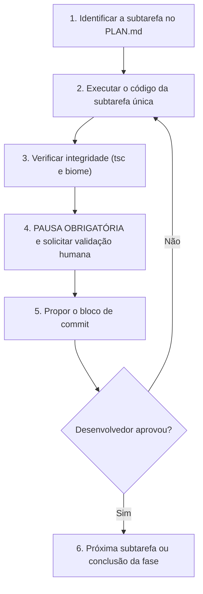

# Guia e Guardrails para Desenvolvimento Agêntico — Projeto VerdeAr

Regras inegociáveis, padrões e protocolo de trabalho obrigatório para qualquer agente de IA que atue neste repositório. A arquitetura, os requisitos e o andamento do projeto ficam em `docs/` (`ARQUITETURA.md`, `REQUISITOS.md` e `ANDAMENTO.md`) e devem ser lidos antes de propor mudanças.

> [!IMPORTANT]
> **A IA nunca assume autonomia cega e nunca executa escrita no Git.** Toda modificação de código segue o fluxo subfaseado, com pausa e validação humana explícita antes de avançar para a etapa seguinte.

---

## 1. Princípio fundamental de operação

O agente atua em regime de **pair programming supervisionado**. Seu papel é acelerar a implementação técnica mantendo precisão arquitetural, tipagem estrita e segurança.

- **Princípio da menor alteração:** altere estritamente o necessário para cumprir os critérios de aceite. Não refatore trechos não relacionados sem solicitação.
- **Respeito a tipos e contratos:** mantenha compatibilidade com os modelos e contratos de dados existentes.
- **Tratamento de erros:** não ignore blocos de captura nem retorne respostas silenciosas. Toda falha de integração ou de regra deve ser tratada.
- **Segurança:** nunca grave senhas, tokens ou URLs de ambiente no código; use sempre variáveis do `.env`.

---

## 2. Protocolo de entrada de tarefas (Jira e contexto MCP)

Ao receber uma demanda ou chave de tarefa (ex.: `VER-44`):

1. **Consulta via MCP (Jira):** consulte a issue para extrair título, descrição, critérios de aceite, tipo (Tarefa, História ou Subtarefa) e status.
2. **Contexto complementar:** se a tarefa citar regras de negócio, consulte `docs/` (`REQUISITOS.md`, `ARQUITETURA.md`) e o Notion (*Regras de Negócio & Glossário* e *Requisitos do VerdeAr*).
3. **Planejamento no `PLAN.md`:** estruture as atividades em subfases e subtarefas atômicas no `.agents/PLAN.md` deste repositório (o arquivo traz o modelo; preencha-o para cada nova tarefa), antes de alterar qualquer código.
4. **Alinhamento inicial:** apresente ao desenvolvedor um resumo objetivo do entendimento da demanda e a lista exata dos arquivos que serão criados ou editados, antes de iniciar a primeira subtarefa.

---

## 3. Protocolo de execução subfaseada atômica (obrigatório)



1. **Uma subtarefa por vez.** É proibido implementar várias subtarefas em um único prompt.
2. **Verificação prévia obrigatória.** Antes de pedir validação, os arquivos alterados devem passar sem erros em `tsc --noEmit` e em `npm run check` (Biome com `--error-on-warnings`).
3. **Pausa e solicitação de validação.** Apresente:
   - um resumo claro e conciso das alterações;
   - os arquivos modificados e criados;
   - o comando de commit sugerido;
   - e finalize com a pergunta: *"Subtarefa [X.Y] finalizada e verificada. Podemos validar essa etapa e prosseguir para a próxima subtarefa?"*
4. **Aguardar a validação humana.** Interrompa o raciocínio e só inicie a próxima subtarefa após a resposta do desenvolvedor.

---

## 4. Padrão Git, branches e commits

### Política estrita de controle Git (somente comandos manuais)

- A IA está **proibida** de executar comandos de escrita no Git (`git commit`, `git push`, `git checkout -b`, `git merge` etc.) por conta própria, no terminal ou por ferramentas automatizadas.
- Toda ação Git é entregue em um **bloco de código** para o desenvolvedor conferir e executar manualmente neste repositório.
- Ao encerrar uma tarefa, lembre o desenvolvedor de revisar com `git status` e `git diff`, entregue o comando de commit pronto e sugira o `git push` quando couber.

### Nomenclatura de branches (rastreabilidade Jira)

Toda branch parte da versão mais recente da `main` e usa o **ID da própria tarefa (subtarefa) que será executada**, e não o da Tarefa Pai. Cada subtarefa tem a sua branch, e o mesmo ID aparece no nome da branch e nos commits.

```bash
<tipo>/VER-<ID>-<descricao-curta-em-portugues>
```

- **Idioma:** português, em minúsculas, com hífens e **sem acentos** (ex.: `validacao-pagamento`).
- **Tipos:** os mesmos dos commits (`feat`, `fix`, `refactor`, `chore`, `docs`, `test`).
- **Comportamento da IA:** consulte a issue no Jira e use a própria chave informada. Não busque o campo `parent` para montar o nome.
- **Exemplos:**
  - `feat/VER-105-validacao-pagamento`
  - `fix/VER-110-calculo-frete-carrinho`
  - `chore/VER-44-auditoria-e-swagger`

### Padrão de mensagens de commit

Cada subtarefa concluída gera uma proposta de commit em **Conventional Commits**, redigida em **português**, no modo imperativo e com o ID da tarefa:

```bash
<tipo>(<escopo>): [VER-<ID>] <descricao curta e objetiva no imperativo, em portugues>
```

> [!IMPORTANT]
> **Limite de 100 caracteres** para a mensagem inteira (tipo, escopo, ID entre colchetes, espaços e descrição). Acima disso, o Commitlint rejeita o commit.

| Tipo | Quando usar |
|---|---|
| `feat` | Nova funcionalidade, endpoint ou componente visual |
| `fix` | Correção de bug ou comportamento inesperado |
| `refactor` | Mudança estrutural sem alterar o comportamento externo |
| `chore` | Configuração, dependências, build, tooling ou documentação operacional |
| `docs` | Atualização exclusiva de documentação |
| `test` | Criação ou ajuste de testes |

Exemplos:

```bash
feat(checkout): [VER-105] cria validacao dos campos de pagamento
fix(carrinho): [VER-110] corrige calculo do frete por produtor
docs(readme): [VER-108] atualiza instrucoes de setup
```

Antes de sugerir `git checkout -b` ou `git commit`, valide a chave no Jira e monte o nome da branch e o prefixo do commit já com o `[VER-<ID>]` correto.

---

## 5. Tipagem estrita (type safety)

- **`any` é proibido** neste repositório.
- **Inferência a partir do Zod:**
  ```typescript
  export const productSchema = z.object({ /* ... */ });
  export type ProductInput = z.infer<typeof productSchema>;
  ```
- **Asserções seguras:** evite `as Tipo` quando houver `type guard` ou `z.nativeEnum`.
- **Compilação limpa:** todo código entregue passa em `tsc --noEmit`.

---

## 6. Idiomas do projeto

| Item | Idioma |
|---|---|
| Comentários de código | Português (Brasil) |
| Mensagens de commit | Português (Brasil) |
| Nomes de branches | Português, sem acentos |
| Documentação (`docs/`, `README.md`, `PLAN.md`), explicações em chat e diálogo com o desenvolvedor | Português (Brasil) |
| Nomes de variáveis, funções, tipos, arquivos e identificadores do código | Inglês, como já é o padrão do código |
| Rotas HTTP do domínio (`/produtos`, `/carrinho`) e mensagens exibidas ao usuário | Português (Brasil) |

---

## 7. Documentação em dia

Quando a alteração mudar comportamento, rotas, variáveis de ambiente, modelo de dados ou fluxos, atualize `README.md`, `docs/ARQUITETURA.md` e, se couber, `docs/REQUISITOS.md` e `docs/ANDAMENTO.md` na mesma entrega, e inclua esses arquivos na lista da proposta de implementação.

---

## 8. Guardrails de arquitetura do frontend (React 19, Tailwind v4, Vite e shadcn)

Este repositório é **somente a SPA**; a API fica em `VerdeAr/backend`. Não implemente regra de negócio que o backend já cobre (frete, total, estoque): o frontend exibe o que a API devolve e valida só para dar resposta imediata. Detalhes de rotas, estado e fluxos estão em `docs/ARQUITETURA.md`.

1. **Mobile-first absoluto:**
   - Os estilos base são sempre os móveis (`w-full`, `flex-col`, `gap-3`), projetados para 375–430 px; use `md:` e `lg:` só para enriquecer telas maiores.
   - Áreas de toque com no mínimo 44 px (`h-11` ou `p-3`).
2. **Componentização profunda e desacoplamento:**
   - Páginas em `src/pages/` apenas orquestram; não misturam formulários, tabelas e modais.
   - Formulários complexos ficam em subcomponentes de `src/components/<módulo>/`.
3. **Camadas:**
   - `src/components/ui/`: primitivos visuais puros (shadcn e Base UI).
   - `src/components/<módulo>/`: subcomponentes de domínio, cada pasta com `index.ts`.
   - `src/services/`: chamadas HTTP (Axios) em funções tipadas; componentes e páginas não usam o Axios diretamente.
   - `src/stores/`: estado global com Zustand; o carrinho tem o backend como fonte da verdade.
   - `src/schemas/`: schemas Zod integrados ao `react-hook-form`, com tipos via `z.infer`.
4. **Rotas e links:** registre telas em `src/router/routes.tsx`, decidindo se ficam sob `ProtectedRoute`, e só crie `Link` para rotas que existam lá.
5. **Tipos:** além de proibir `any`, o `tsconfig` ativa `erasableSyntaxOnly`; não use `enum` nem `namespace` e prefira uniões de strings.
6. **Pontos de atenção do domínio:**
   - A vitrine (`/`) e o detalhe do produto (`/produtos/:id`) são **públicos**; carrinho, checkout, pedido confirmado e Minha Conta exigem login.
   - As funções de vendedor ficam em abas de Minha Conta (`?aba=`) e aparecem só para `role === "VENDEDOR"`; a autoridade final é o backend.
   - A sessão é um JWT em **cookie HTTP-Only** (VER-74): nunca leia, grave ou persista o token no frontend (`localStorage`, `sessionStorage`, `document.cookie`); o Axios usa `withCredentials: true`.
   - Ainda sem tela: avaliação de pedidos (VER-78) e chat (VER-58); não assuma que existem.
