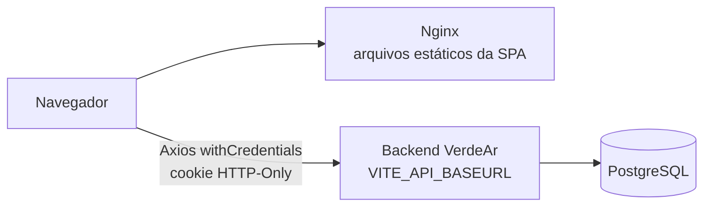
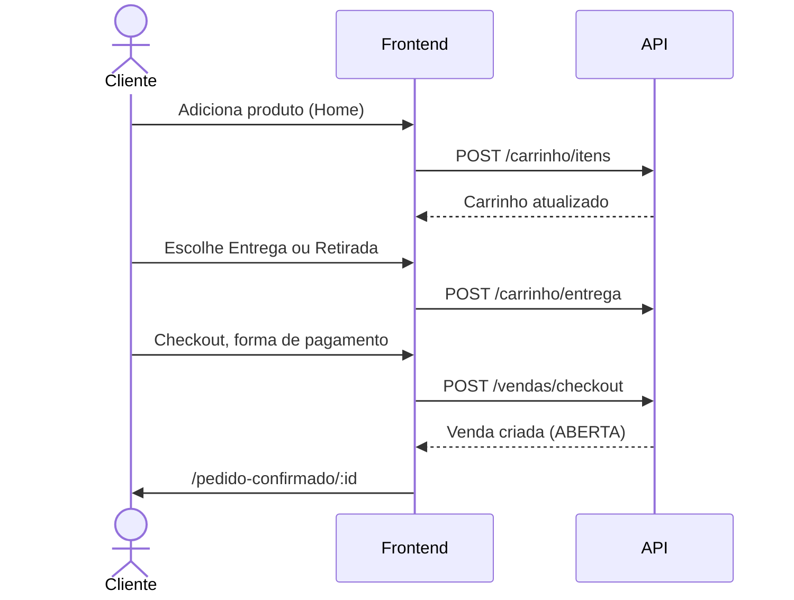

# Arquitetura do Frontend — VerdeAr

Este repositório (`VerdeAr/frontend`) contém a Single Page Application (SPA) do VerdeAr, que substitui a camada de visualização do monolito legado [`VerdeAr/Verdear`](https://github.com/VerdeAr/Verdear). A interface é responsiva e mobile-first. A API consumida é o repositório irmão [`VerdeAr/backend`](https://github.com/VerdeAr/backend).

O VerdeAr é um marketplace que conecta produtores familiares e orgânicos (**Vendedores**) a consumidores (**Clientes**). A jornada de cada perfil está descrita no Notion, na página *VerdeAr — Visão Geral do Produto*.

---

## 1. Status da migração do monólito

Telas e fluxos já disponíveis:

| Área | O que existe |
|---|---|
| Autenticação | Login e Cadastro (com papel Cliente ou Vendedor e campos de produtor rural), edição de dados, troca de senha. |
| Vitrine pública | Home com banner rotativo, busca, filtro por categoria e paginação. Acessível sem login. |
| Detalhe do produto (PDP) | Página pública `/produtos/:id`, aberta ao clicar no card do produto. Mostra galeria, nome, preço, estoque, descrição, média e quantidade de avaliações, card do produtor, simulador de frete e barra de ações (quantidade e adicionar ao carrinho). |
| Carrinho | Itens, resumo de valores e seletor de entrega (**Entrega** com frete ou **Retirada**), sincronizados com a API. |
| Checkout | Resumo, endereço de entrega, forma de pagamento e tela de pedido confirmado com instruções. |
| Minhas Compras | Histórico de compras do usuário logado. |
| Painel do vendedor | Dentro de Minha Conta: Pedidos Recebidos, Meus Produtos (cadastro, edição e ativar/desativar) e Frete e Entrega. |

Ainda **não implementado** no frontend, embora a API já exista ou esteja modelada:

- **Avaliação pós-venda** (VER-78, em desenvolvimento): a API de avaliações já existe e a PDP já exibe a média e a quantidade de avaliações do produto. Faltam `StarRatingInput`, `ReviewOrderModal` (o cliente avaliar um pedido finalizado) e a exibição da reputação nos cards de produto e no perfil do produtor.
- **Chat** entre cliente e vendedor (VER-58, em desenvolvimento): o ícone do Header e o link do Footer apontam para `/chat`, que ainda não tem rota.
- **Busca mobile:** o botão de busca no Header (telas pequenas) aponta para `/produtos/busca`, que também não tem rota.

Essas rotas inexistentes caem em uma página de erro padrão do React Router até serem criadas ou removidas.

---

## 2. Stack tecnológica

| Camada | Tecnologia |
|---|---|
| Build e dev server | Vite 8 + npm |
| Linguagem | TypeScript 6 |
| UI | React 19 (`StrictMode`) |
| Estilização | Tailwind CSS v4 (plugin `@tailwindcss/vite`) e `tw-animate-css` |
| Componentes | shadcn (`components.json`) sobre `@base-ui/react`, `class-variance-authority` e `lucide-react` |
| Roteamento | React Router 8 em data mode (`createBrowserRouter` com loaders) |
| Formulários | React Hook Form + Zod + `@hookform/resolvers` |
| Estado global | Zustand (`auth` e `cart`; nenhum dos dois guarda o token) |
| HTTP | Axios com `withCredentials: true` (sessão por cookie HTTP-Only) |
| Documentos | `cpf-cnpj-validator` |
| Datas | `date-fns` |
| Qualidade | Biome |
| Git hooks | Husky + Commitlint |
| Container | Docker multi-stage com Nginx Alpine |

Alias de importação: `@/*` aponta para `src/*` (configurado no `vite.config.ts` e no `tsconfig.app.json`).

---

## 3. Visão de sistema



O frontend é 100% estático. Em produção, o Nginx serve o `dist/` e todas as rotas desconhecidas voltam para o `index.html`, o que permite ao React Router resolver o caminho. A URL da API é fixada **no build** pela variável `VITE_API_BASEURL`.

---

## 4. Estrutura de pastas

```
src/
├── main.tsx            # Entrada: StrictMode e RouterProvider
├── index.css           # Tailwind e tokens de tema
├── components/
│   ├── account/        # Dados cadastrais, senha, frete do vendedor e histórico de compras
│   ├── auth/           # LoginForm, RegisterForm, ProtectedRoute e RoleRoute
│   ├── cart/           # CartItemList, CartItemRow, CartSummary, DeliverySelector, CartBadge
│   ├── catalog/        # ProductGrid, ProductCard, CategorySelector, SearchBar, HeroBannerCarousel
│   ├── checkout/       # CheckoutSummaryCard, DeliveryAddressCard, PaymentMethodSelector, OrderItemsList
│   ├── layout/         # RootLayout, Header e Footer
│   ├── pdp/            # ProductGallery, ProductHeaderInfo, ProductSellerCard, ProductShippingSimulator, ProductActionsBar
│   ├── seller/         # Catálogo, formulário de produto e gestão de pedidos do produtor
│   └── ui/             # Primitivos (Button, Card, Dialog, Input, Select, Switch, Badge, Skeleton...)
├── lib/                # api.ts (Axios), formatters.ts, masks.ts e utils.ts
├── pages/              # Home, ProductDetailPage, Login, Register, CartPage, CheckoutPage, OrderSuccessPage, AccountSettingsPage
├── router/             # routes.tsx (árvore de rotas) e loaders.ts (dados da Home, do produto e do carrinho)
├── schemas/            # Schemas Zod: auth, person, product
├── services/           # Uma função por chamada à API, tipada
├── stores/             # auth.store.ts e cart.store.ts
└── types/              # auth, cart, catalog, sale e models
```

Outros arquivos relevantes: `public/images/` (logos e banners), `nginx.conf`, `Dockerfile`, `components.json`, `biome.json`, `.husky/`.

---

## 5. Roteamento e acesso

Definido em `src/router/routes.tsx`, todas sob `RootLayout`:

| Caminho | Página | Acesso |
|---|---|---|
| `/` | Home (loader `homeLoader`) | Público |
| `/login` | Login | Público (logado é redirecionado para `/`) |
| `/cadastro` | Cadastro | Público (logado é redirecionado para `/`) |
| `/produtos/:id` | Detalhe do produto (loader `productDetailLoader`) | Público |
| `/minha-conta` | Minha Conta | Logado |
| `/carrinho` | Carrinho (loader `cartLoader`) | Logado |
| `/checkout` | Checkout | Logado |
| `/pedido-confirmado/:id` | Confirmação do pedido | Logado |

- **`ProtectedRoute`** envolve as rotas privadas e redireciona o visitante para `/login`, guardando a origem em `state.from`.
- **`RoleRoute`** existe para restringir por papel, mas **não é usada** no roteador hoje. A separação de vendedor acontece dentro de Minha Conta (abaixo) e, de forma definitiva, no backend.
- **Minha Conta** usa abas controladas pelo parâmetro `?aba=`. O valor é normalizado e aceita sinônimos em português e inglês: `profile`, `purchases`/`compras`, `security`/`seguranca`, e as exclusivas de vendedor `orders`/`pedidos`, `products`/`produtos` e `shipping`/`frete`. As abas de vendedor só aparecem quando `user.role === "VENDEDOR"`.
- **Home pública:** adicionar um produto ao carrinho sem login leva ao `/login` com a origem salva.

### Filtros da Home na URL
O estado de busca vive na query string, o que torna a vitrine compartilhável e funciona com o botão voltar:

| Parâmetro | Uso |
|---|---|
| `categoria` | ID da categoria |
| `q` | Termo de busca |
| `pagina` | Página atual (12 produtos por página) |

O `homeLoader` lê esses parâmetros e busca categorias e produtos em paralelo. Em caso de falha, retorna listas vazias com uma mensagem de erro em vez de quebrar a página.

### Detalhe do produto (`/produtos/:id`)
- O `productDetailLoader` busca o produto (`GET /produtos/:id`) e os bairros (`GET /bairros`) em paralelo. Se os bairros falharem, a página abre mesmo assim com a lista vazia.
- Se o produto não existir, estiver inativo ou esgotado, a própria página exibe o estado "Produto não encontrado" com o botão de voltar ao catálogo. Não há redirecionamento.
- `ProductHeaderInfo` mostra `average_rating` e `review_count` vindos da API; sem avaliações, exibe "Novo" e "Ainda sem avaliações".
- `ProductActionsBar` tem o seletor de quantidade (de 1 até o estoque) e o botão de adicionar à sacola. Sem login, o visitante é enviado ao `/login` e volta para o produto depois.
- `ProductSellerCard` mostra o nome da fazenda, o responsável e a descrição do produtor, com texto padrão quando faltam dados.
- `ProductShippingSimulator` é **informativo**: mostra a taxa fixa do produtor (ou uma estimativa de R$ 10,00 se o produtor não tiver taxa) e "Retirada: Grátis". O bairro escolhido não altera o valor, e o frete real é sempre o calculado pela API no carrinho.

---

## 6. Estado global e dados

### `auth.store` (Zustand)
- Guarda apenas os dados do usuário (`user`) e `isAuthenticated`. **O token JWT nunca é lido, gravado nem persistido pelo frontend**: `localStorage`, `sessionStorage` e `document.cookie` não contêm token.
- `login` e `register` chamam a API, que grava o JWT em um cookie `HttpOnly` na resposta. O store só recebe o usuário.
- A sessão é restaurada validando o cookie no backend (`GET /auth/me`), e não lendo dados locais.
- `logout` chama `POST /auth/logout`, para o servidor limpar o cookie, e zera o estado. Também é disparado automaticamente em respostas 401.

### `cart.store` (Zustand, sem persistência)
- A fonte da verdade do carrinho é o **backend**. O store guarda o último `CartResponse` e recarrega após cada operação.
- `RootLayout` chama `fetchCart` sempre que o usuário está autenticado.
- Expõe ações (`addItem`, `updateQuantity`, `removeItem`, `clearCart`, `setDeliveryType`, `setPaymentMethod`) e seletores atômicos (`selectCartItems`, `selectCartTotal`, `selectDeliveryType` etc.) para evitar re-renderizações desnecessárias.
- Subtotal, frete e total vêm calculados pela API; o frontend só exibe.

### Camada de serviços
`src/services/` concentra as chamadas HTTP, uma função por endpoint: `auth`, `cart`, `catalog`, `neighborhood`, `sale` e `seller-products`. Páginas e componentes não chamam o Axios diretamente.

### Cliente HTTP (`lib/api.ts`)
- `baseURL` vem de `VITE_API_BASEURL`; se vazia, usa `http://localhost:3000`. Timeout de 15 s.
- **`withCredentials: true`:** o navegador envia o cookie de sessão automaticamente em toda requisição. Não existe interceptor que monte o cabeçalho `Authorization`.
- **Interceptor de resposta:** em 401, dispara o logout registrado pelo `auth.store`.
- **Não há refresh token.** A sessão dura o tempo de validade do JWT (7 dias); depois disso o usuário precisa entrar de novo.
- **Mesmo site:** como o cookie é `SameSite`, o frontend e a API devem ser servidos no mesmo site (por exemplo, subdomínios do mesmo domínio). Em domínios totalmente diferentes, o cookie precisaria de `SameSite=None; Secure`, e a origem do frontend deve estar em `CORS_ORIGIN` do backend.

---

## 7. Formulários e validação

- Formulários usam React Hook Form com schemas Zod de `src/schemas/` (`auth`, `person`, `product`).
- CPF e CNPJ são validados com `cpf-cnpj-validator`; máscaras de entrada ficam em `lib/masks.ts` e formatadores de moeda e data em `lib/formatters.ts`.
- Regras equivalentes são reaplicadas no backend, que é a autoridade final. O frontend valida para dar resposta imediata ao usuário.
- Erros da API chegam em `response.data.message`, exibido no formulário ou no resumo do checkout.

---

## 8. Fluxos principais

### Compra


Antes de finalizar uma **Entrega**, o checkout exige endereço cadastrado no perfil do cliente. A forma de pagamento padrão sugerida é PIX.

### Gestão do vendedor
Em Minha Conta, o vendedor cadastra e edita produtos (`/vendedor/produtos`), ativa ou desativa anúncios, acompanha pedidos (`/vendedor/pedidos`) e define o frete fixo (`/pessoa/frete`). O Header mostra um atalho para os pedidos com o contador de pendentes (`/vendedor/pedidos/pendentes/count`), carregado uma vez ao montar o Header.

---

## 9. Diretrizes arquiteturais

1. **Mobile-first:** layouts criados para 375–430 px e ampliados com `sm:`, `md:` e `lg:`; áreas de toque com no mínimo 44 px (`h-11 w-11`).
2. **Páginas orquestradoras:** `src/pages/` apenas compõe componentes; formulários e listas complexas ficam em componentes próprios por domínio.
3. **Componentes por domínio:** cada pasta de `components/` tem um `index.ts` que reexporta o que é público.
4. **Dados via loaders e stores:** dados de rota entram por loaders; estado compartilhado por Zustand; chamadas HTTP só em `services/`.
5. **Type safety:** `any` é proibido. O `tsconfig.app.json` ativa `noUnusedLocals`, `noUnusedParameters`, `verbatimModuleSyntax` e `erasableSyntaxOnly` (sem `enum` ou `namespace`; use uniões de strings).
6. **Qualidade:** `npm run check` (`tsc --noEmit` + Biome com `--error-on-warnings`) deve passar antes de abrir PR. `npm run format` corrige o estilo.
7. **Idioma:** textos de interface, comentários e rotas em português do Brasil.

---

## 10. Limitações conhecidas

- **Sem testes automatizados** e sem pipeline de CI neste repositório.
- **Rotas órfãs:** `/chat` e `/produtos/busca` são linkadas no Header e no Footer, mas não existem. O chat está em desenvolvimento (VER-58); a busca mobile ainda não tem tarefa associada. Também não há `errorElement` nem página 404 (previstos na VER-55).
- **Funcionalidades da API sem tela:** o envio de avaliações (ver seção 1).
- **Simulador de frete da PDP:** o valor exibido é uma estimativa e pode diferir do frete do carrinho, que soma a taxa de cada produtor.
- **`RoleRoute` não utilizado** e **sem refresh token** (ver seções 5 e 6).
- **Sem pasta `hooks/`:** a lógica reutilizável hoje vive nos stores e nos componentes.
- **Avaliações em desenvolvimento** (VER-78): componentes de estrelas, modal de avaliação do pedido e exibição de reputação ainda não existem.

---

## 11. Setup local e execução

### Pré-requisitos
- Node.js 20 ou superior
- Backend do VerdeAr em execução (padrão `http://localhost:3000`)

### Passos
```bash
cp .env.example .env     # defina VITE_API_BASEURL=http://localhost:3000
npm install
npm run dev              # http://localhost:5173
```

Build de produção: `npm run build` (executa `tsc -b` e `vite build`); prévia local com `npm run preview`.

### Docker
```bash
docker build --build-arg VITE_API_BASEURL=https://api.seudominio.com -t verdear-frontend .
docker run -p 8080:80 verdear-frontend
```

O `nginx.conf` faz fallback de SPA, cache de um ano para assets estáticos, `no-store` para o `index.html` e compressão gzip. Lembre-se de incluir a origem do frontend em `CORS_ORIGIN` no backend.

---

## 12. Fluxo de trabalho

Branches seguem o GitLab Flow, descrito em [GITFLOW.md](GITFLOW.md), e cada branch usa o ID da própria tarefa (`<tipo>/VER-<ID>-<descricao-curta-em-portugues>`). Commits seguem Conventional Commits, em português, com o mesmo ID e até 100 caracteres (`feat(carrinho): [VER-105] cria seletor de quantidade`). O protocolo completo de trabalho com IA está em `.agents/AGENTS.md`. O Pull Request precisa de revisão por pares (os responsáveis estão no arquivo `CODEOWNERS`) e de `npm run check` passando. O andamento das tarefas está em [ANDAMENTO.md](ANDAMENTO.md).
